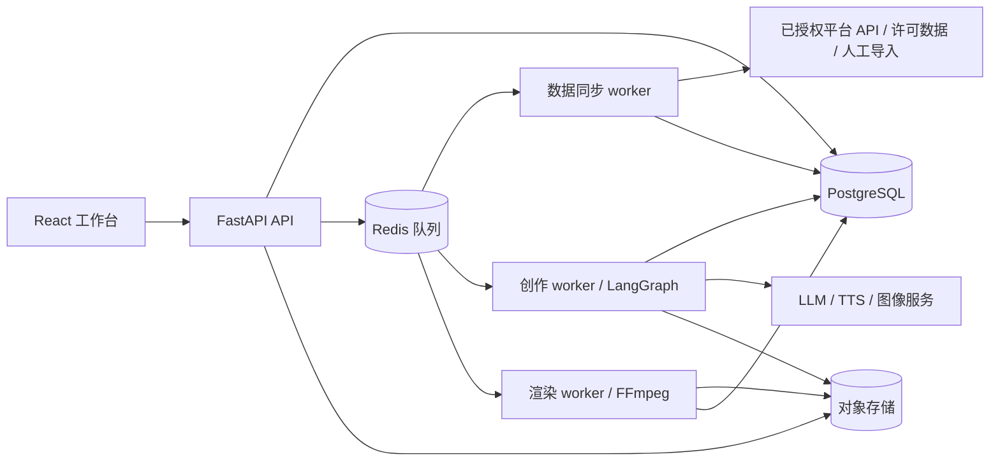
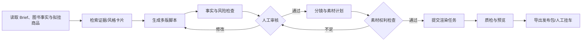

# 系统架构与技术设计

版本：v0.2；日期：2026-10-28。此文为目标设计，不代表已部署。

## 1. 技术选择

| 层 | 建议 | 理由 |
| --- | --- | --- |
| Web 前端 | React + TypeScript + Vite；React Router、TanStack Query、Ant Design、ECharts | 首期是登录后的数据工作台，交互和图表多，SEO 需求低；Vite 提供官方 React TS 模板，保持 Python API 为唯一业务后端 |
| API | Python + FastAPI + Pydantic | 负责鉴权、项目/数据 CRUD、任务提交与状态查询、OpenAPI 契约 |
| AI 编排 | LangGraph | 编排研究摘要、风格提炼、脚本、事实核验、人工审核和分镜；用持久化 checkpoint 支持暂停/恢复 |
| 异步执行 | 独立 worker + Redis 队列；具体队列库在实施时定型 | 数据同步和媒体渲染是长任务，不占用 API 进程；LangGraph 处理创作流程状态，队列处理交付与并发 |
| 数据 | PostgreSQL；对象存储（S3 兼容）；Redis | 结构化业务数据与图执行状态；媒体及原始快照；短期缓存和队列 |
| 媒体 | FFmpeg + 原创文字/图形模板 + 可商用 TTS 适配层 | 首期无需图书/第三方视频素材；供应商可替换，保存输入、费用和许可信息 |

前端选择依据：[Vite React TS 模板](https://vite.dev/guide/)、[TanStack Query 文档](https://tanstack.com/query/latest/docs/framework/react/overview)、[Ant Design 组件](https://ant.design/components/overview/)。若将来需要公开的可索引商品页/营销站，再单独评估 Next.js；其 App Router 支持服务端渲染，见[官方文档](https://nextjs.org/docs/app)。FastAPI 官方也建议重计算使用独立任务系统，见[Background Tasks 说明](https://fastapi.tiangolo.com/tutorial/background-tasks/)。

## 2. 逻辑架构

**职责边界**：API 不直接进行耗时推理或渲染；平台连接器只处理该平台权限、拉取和字段映射；领域服务负责图书、指标和证据；LangGraph 只编排多步骤创作，不能代替业务数据库；渲染 worker 只使用已确认的脚本与自制/授权素材。前端不持有第三方平台 token。封测用户从第一天按 `owner_user_id` 隔离数据，暂不建设复杂多租户计费体系。

## 3. LangGraph 创作图

`CreativeState` 只保存项目 ID、证据 ID、Brief 版本、脚本/分镜版本、审核状态、错误与任务 ID；长媒体文件放对象存储。节点输出写入业务表并保留版本。每个外部调用用幂等键（项目 ID + 版本 + 节点 + 参数哈希）避免恢复时重复执行或重复计费。模型输出必须通过结构化校验；事实检查用证据匹配和人工复核，不把 LLM 自检当成最终事实证明。审核节点用 LangGraph interrupt 暂停，生产环境使用持久化 checkpointer；见[持久化](https://docs.langchain.com/oss/python/langgraph/persistence)与[中断恢复](https://docs.langchain.com/oss/python/langgraph/interrupts)。

## 4. 数据与 API 草案

数据库业务表分组：`users/invitations`、`platform_connections/source_grants/sync_runs`、`books/book_facts/product_listings/promotion_candidates`、`creator_accounts/content_items/metric_observations/evidence`、`style_cards/research_projects`、`creative_projects/script_versions/storyboards/assets/reviews/render_jobs/publication_packages`、`audit_events/cost_events`。对平台原生 ID 建唯一键（平台 + 类型 + ID）；私有记录带 `owner_user_id`；对指标保存来源和时间窗。若后续确需团队协作，再迁移到 tenant_id 模型。

REST API 草案（`/api/v1`）：

| 路径 | 用途 |
| --- | --- |
| `POST /books`、`GET /books/{id}` | 建立/查询图书版本与事实 |
| `POST /imports`、`GET /sources` | 导入数据、查看可用来源与权限 |
| `GET /research/items`、`GET /research/accounts` | 按平台、时间和图书筛选证据 |
| `POST /style-cards`、`GET /style-cards/{id}` | 保存风格卡片及证据引用 |
| `POST /creative-projects`、`POST /creative-projects/{id}/runs` | 创建项目和发起生成 |
| `GET /runs/{id}`、`GET /runs/{id}/events` | 状态/阶段事件；事件流可用 SSE |
| `POST /runs/{id}/review` | 审核、批注、驳回、恢复图执行 |
| `POST /renders`、`GET /renders/{id}` | 提交渲染、取得预览与下载地址 |
| `GET /creative-projects/{id}/publication-package` | 下载 MP4、文案、拟挂商品及人工挂车检查卡 |

异步写操作返回任务 ID；长任务状态为 `queued/running/waiting_review/succeeded/failed/cancelled`，每次状态迁移记录时间和原因。外部回调验签；下载用短期签名 URL；接口与对象存储均按 `owner_user_id` 授权，后续团队协作再扩展租户模型。

## 5. 部署与运维

- **环境**：开发、预发、生产隔离；数据库迁移可回滚；对象存储桶按环境隔离。
- **观测**：以 `request_id/project_id/run_id/source_id` 关联 API、图节点、队列和渲染日志；记录耗时、错误率、第三方配额和单条视频成本。
- **资源控制**：按用户限并发/预算；媒体文件设置生命周期；重试限次数并使用指数退避；不可重试错误直接进入人工处理。
- **安全**：OAuth 凭据加密、最小权限、审计日志、用户间数据隔离；模型输入不包含非必要个人信息；供应商及数据跨境条件在选型前核对。
- **恢复**：数据库和对象存储备份；队列重放须幂等；Graph checkpoint 保留策略与业务版本分离。

## 6. 分阶段实现建议

**阶段 0：本人验证**。选择 1–2 本确实可推广的书，手工录入已核实事实和原创观点；用自制文字/图形与已核实声音许可生成样片，亲自在抖音/快手客户端验证发布及挂车流程。数据接口可并行做权限摸底，不阻塞创作样片。

**阶段 1：封闭测试**。邀请 5–20 位小型创作者；提供各自数据隔离、图书事实、人工/授权数据导入、研究台、风格卡片、脚本生成、本人确认、模板视频渲染与发布包。

**阶段 2：扩展**。更多数据源、自有账号表现回传、批量任务、A/B 复盘和可选生成式镜头。快手自动发布/挂车仅在申请到 `USER_VIDEO_PUBLISH` 等必要权限并验证商品 ID 规则后评估；抖音自动挂小黄车需要单独核实实际可用能力，不以普通视频发布权限推断。
