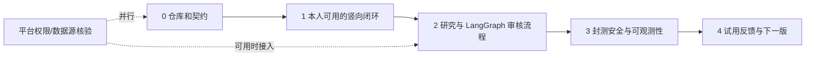

# 开发计划与 Codex 多 Agent 执行方案

版本：v0.1；日期：2026-10-28；状态：计划，尚未启动开发。

依据：[PRD](./01-PRD.md)、[数据接入](./02-数据接入与指标.md)、[系统架构](./03-系统架构.md)、[交互与目录](./04-交互与目录.md)。目标是先让你本人完成「选书 → 原创脚本 → 成片 → 手动挂小黄车」的闭环，再邀请 5–20 位创作者封测。数据接口申请与商业授权有外部不确定性，不能作为首个可用版本的阻塞项。

## 1. 交付顺序



建议按**交付关口**推进，而非让所有 Agent 一次性完成整个系统。若 1 位人类负责人持续评审、3 个实现 Agent 并行，首个可自己使用的闭环可按约 2–3 周规划；达到小规模封测再预留约 1–2 周。时间只是排期假设，平台授权、TTS 商用许可、模型调用质量和反馈修改可能改变进度。

| 阶段 | 目标与主要工作 | 完成判据 | 依赖 |
| --- | --- | --- | --- |
| 0. 基线与契约 | 初始化 Git；补 `AGENTS.md`、启动方式、最小 CI；确定目录、OpenAPI 草案、任务状态、素材许可字段；准备 1–2 本书的人工样本与原创观点 | 所有人使用同一契约与样本；开发环境能启动空 API/Web/worker；样本不含未经授权图片/内文 | 你提供可推广商品和测试账号；TTS 许可可后续确定 |
| 1. 竖向闭环 | 图书与商品录入、Brief、最小 LangGraph 脚本生成、脚本编辑、文字动效渲染、MP4/文案/商品核对卡导出 | 你用一件图书商品从创建项目走到下载可播放视频，随后在平台客户端手动发布并挂车；系统不声称已自动挂车 | 阶段 0 契约 |
| 2. 研究与编排 | 人工/CSV 证据导入、来源时间窗、风格卡片；扩展 LangGraph 为多方案脚本、事实检查、人工确认与断点恢复 | 研究卡片可追溯；生成流程中断后可恢复；错误不会重复渲染或重复记费；缺授权素材被拦截 | 阶段 1 闭环 |
| 3. 封测准备 | 邀请制登录、按用户隔离、限额、审计、失败重试、基础观测和备份；完善 UI | 以两个测试账号互查不能访问对方数据；至少 5 位试用者可独立完成闭环；失败有可读提示 | 阶段 2；真实账号与素材许可 |
| 4. 反馈迭代 | 修复高频问题、比较脚本/成片质量、统计成本；有权限时接一个合法数据源 | 记录试用者完成率、视频人工修改点、单条视频成本及数据覆盖；决定下一版优先级 | 封测反馈、平台权限 |

## 2. 并行分工：1 位主 Agent + 3 位实现 Agent

| 角色 | 独占修改路径 | 首轮交付 | 明确边界 |
| --- | --- | --- | --- |
| 主 Agent／集成负责人 | `docs/`、`packages/contracts/`、`infra/`、根目录配置、跨模块集成 | 固定契约、拆任务、处理依赖、跑端到端验收、合并变更 | 不把互相依赖的接口改动直接交给多位 Agent 同时写 |
| Agent A：领域/API | `apps/api/src/book_video/api/`、`core/`、`domain/`、`persistence/`、`connectors/manual/`、`apps/api/migrations/` | 图书、商品、证据、项目 API 与数据库 | 不编辑 `workflows/`、`media/` 或前端 |
| Agent B：前端 | `apps/web/` | 图书录入、研究、脚本编辑、任务进度、发布包页面 | 只使用已冻结的 API 契约；不修改后端或生成客户端的源契约 |
| Agent C：生成链 | `apps/api/src/book_video/workflows/`、`media/`、`tasks/` | 脚本编排、事实检查、暂停确认、文字动效/TTS/FFmpeg 渲染 | 通过约定的领域接口访问数据；不改 API 路由与数据库模型 |

测试文件随所属模块由对应 Agent 维护；跨模块端到端测试由主 Agent 维护。若某项任务确需跨边界，先由主 Agent 调整契约并明确移交文件，再继续并行。平台数据权限调查可作为独立的**只读**任务交给空闲 Agent；未拿到授权前不启动爬取或承诺销量能力。

### 为什么先冻结契约

三条实现线都依赖 `BookEdition`、`PromotionCandidate`、`Evidence`、`CreativeProject`、`RunStatus`、`PublicationPackage` 等共享字段。阶段 0 由主 Agent 给出 OpenAPI、事件载荷和示例数据。之后接口变更走「提出变更 → 更新契约与样本 → 通知受影响 Agent → 分支同步」四步，避免前端和生成链各自猜测字段。

## 3. 每一轮并行工作的节奏

1. **主 Agent 开轮**：选定一个可演示的纵向目标；列出 3 个互不重叠的任务卡，每张卡明确输入文件、输出路径、验收命令和不做的内容。
2. **各 Agent 实施**：在自己的路径完成最小可运行实现与必要测试；遇到契约冲突只报告，不擅自改共享文件。
3. **主 Agent 汇合**：按 API → 生成链 → 前端的依赖顺序集成，运行数据库迁移、类型检查和一条端到端样例；修复跨模块问题。
4. **你验收**：查看可运行演示、实际样例视频、来源和费用记录；确认进入下一轮。每轮最好能交付一个可体验能力，而非只交付大量孤立代码。

**Git 工作方式**：当前目录尚不是 Git 仓库。正式开工时先初始化仓库并提交阶段 0 基线。若使用同一 Codex 聊天中的子 Agent，它们共享文件系统，因此严格按上表划分路径，主 Agent 负责集成与提交。若改用多个独立 Codex 任务并行，给每条工作流独立分支/工作树，由主 Agent 顺序合并；工作树方案需要先有 Git 仓库。不要让两个 Agent 同时修改迁移、OpenAPI、锁文件或根配置。

OpenAI 官方多 Agent 文档也建议把子任务限定为独立、有明确预期结果的工作，并协调共享文件修改；见[Multi-agent 文档](https://developers.openai.com/api/docs/guides/agents-api/multi-agent)。Codex 的 `AGENTS.md` 是可选的仓库级指导文件，适合记录目标、约束、测试方式和路径边界；见[官方工作流示例](https://developers.openai.com/cookbook/examples/codex/iterating-development-workflows-with-codex)。

## 4. 任务卡模板

```text
任务 ID：W1-A / W1-B / W1-C
目标：本轮要让用户完成的一个具体动作
先读：docs/01-PRD.md、docs/03-系统架构.md、docs/05-开发计划与多Agent执行.md、当前 OpenAPI 契约
允许修改：明确路径
不得修改：共享契约、其他 Agent 的路径、真实账号/密钥
输入：样例数据、接口/事件定义、已有测试命令
输出：代码、必要测试、运行说明、已知限制
完成判据：可执行的命令或可观察的页面/视频结果
交付报告：改了什么、测试输出、失败/待决策项、涉及的契约变更建议
```

### 启动主 Agent 的提示词（未来开工时复制）

```text
请作为本项目的集成负责人，阅读 docs/README.md 和 docs/05-开发计划与多Agent执行.md。
现在只执行阶段 0：建立 Git 基线、仓库说明和 AGENTS.md，确定 OpenAPI/事件/样例数据契约以及最小开发环境。
完成并验证阶段 0 后，列出阶段 1 的三个互不重叠任务卡；再委派给三个子 Agent，分别负责领域/API、前端、生成链。
每个 Agent 严格遵守文档中的路径归属，不能自行修改共享契约。你负责集成、测试与汇报。不得接入未经授权的平台数据或素材，不做自动挂车。
```

若你在多个独立 Codex 任务中工作，先让主任务完成阶段 0，然后将对应任务卡分别发给三个工作树任务。每个任务完成后在主任务中集成；不要让独立任务分别重新设计整个架构。

## 5. 验收与质量门槛

**阶段 1 演示脚本**：输入一本有可推广商品 ID 的书、已核实基本事实和你自己的荐书观点 → 生成 2 版脚本 → 修改其中一版 → 审核确认 → 渲染 9:16、20–45 秒 MP4 → 下载发布包 → 在平台客户端手动发布并挂车。视频画面只用原创文字/图形及已确认可商用的声音；若 TTS 许可尚未落实，用你自行录制的配音完成试点。

**最低自动检查**：后端领域规则/API 测试；前端类型检查和构建；媒体样片用 `ffprobe` 检查尺寸、时长和音视频流；LangGraph 暂停/恢复与重试幂等测试；封测前做两个账号的越权访问测试。另用一条端到端样例验证从图书录入到发布包下载。测试要验证真实风险，不为每个简单函数写镜像测试。

**人工检查**：逐句核对书籍事实、商品版本和挂车一致性；检查素材许可记录；在抖音和快手各发布一次测试视频并记录平台审核结果。平台账号资格和商品可推广状态由实际账号后台确认。

## 6. 风险与决策点

| 风险 | 处理方式 |
| --- | --- |
| 无竞品合法数据/销量数据 | 阶段 1 依靠人工证据输入；界面明确「未取得」，不伪造榜单；取得许可后再接连接器 |
| 未取得书封/内文授权 | 默认不用于视频；只用原创观点、事实信息、自制图形和合法声音 |
| TTS 商用许可未确认 | 用创作者自录音完成试点；供应商适配层保留，但不得以未核实声音上线 |
| LangGraph 与任务队列重复执行 | 独立持久化状态、幂等键、版本号；明确一项渲染任务只有一个有效结果 |
| 多 Agent 改同一文件 | 主 Agent 独占契约与配置，工作流独占目录；跨边界变更先变更契约再实施 |
| 平台挂车规则变化 | 首版由用户在平台内手动挂车；后续自动化按实际权限重新评估 |

## 7. 本轮计划的边界

此文档只给出执行方案。尚未初始化 Git、创建 `AGENTS.md`、安装依赖、调用模型、连接抖音/快手或生成视频。进入开发时先做阶段 0，再按阶段验收推进。
