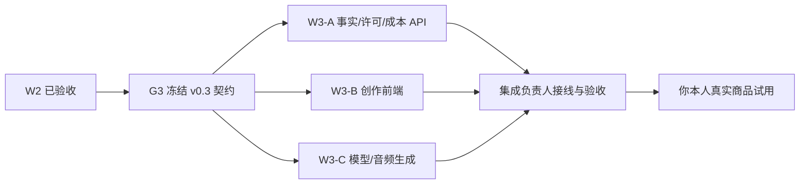

# W2 复核与 G3/W3 启动计划

日期：2026-10-29。本文记录对当前 `main` 的独立复核，并给出下一轮任务。**本次只验收并规划；G3 契约尚未修改，W3 尚未启动。** 路径归属和数据/素材限制以仓库根目录 `AGENTS.md` 为准。

## 1. W2 验收结论

当前 `main` 与 `origin/main` 均指向 `8e17dc6701bf854bcc7d4fc8c5d8e03e0798f0ad`，本次检查前工作区干净。代码提交为 `d88c6621a2c90e5bb571b5eb587aa5937119dde2`；当前 HEAD 相比该代码提交只多了 [W2 集成验收记录](./10-W2集成验收.md)及索引文档。

| 检查 | 本次实测 |
| --- | --- |
| 契约样例 | `python scripts/verify_stage0.py`：通过 |
| API、编排、媒体及集成测试 | `python -m pytest apps/api/tests -q -ra`：**44 passed，0 failed，0 skipped**，约 33 秒 |
| 前端 | `npm run typecheck`、`npm run build`：通过，Vite 构建 29 个模块 |
| 启动 | `python scripts/smoke_stage0.py`：API healthz、worker、Web 均通过 |
| FFmpeg/ffprobe | 当前命令环境能找到两者；媒体集成测试实际运行，生成并用 ffprobe 核对 MP4 |
| GitHub CI | 当前 HEAD 的 [Actions 运行 40838229088](https://github.com/991216982/AI_Video_Generation/actions/runs/40838229088) 为 completed/success，head SHA 与本次 `main` 一致。代码提交的 [Actions 运行 40837622302](https://github.com/991216982/AI_Video_Generation/actions/runs/40837622302) 亦为 success，head SHA 精确对应 `d88c6621…`。 |

W2 的跨进程审核恢复、资格撤回、取消/重试、同 ID 幂等、发布包下载有自动集成测试；[W2 验收记录](./10-W2集成验收.md)还保留了历史项目重开及 API 断连提示的浏览器截图。本次查看了两张截图，界面能展示从 API 恢复的项目与可读的断连错误。结论：**W2 本地软件验收通过，可进入 G3**。

这个结论不包含真实平台带货验收：账号资格、实际商品与书籍版次、声音许可、抖音/快手客户端手动发布和挂车仍需账号持有人完成。当前 `PromotionCandidateCreate` 仍接受旧式直接 `manually_confirmed` 请求，缺少 `confirmation_basis`；W3 前应在 G3 处理该语义。worker 崩溃后执行中任务可等待默认 300 秒 lease 过期，这属于已知恢复延迟。

## 2. 下一步顺序



### G3：集成负责人先做（暂不让实现 Agent 改共享文件）

1. 在 `packages/contracts/` 将 OpenAPI 升为 v0.3，并补齐对应事件与**虚构**样例、迁移说明及验证脚本。保持 v0.2 原有读写路径；对不得继续兼容的行为写明错误码和客户端影响。
2. 明确拟挂商品的创建语义：新候选商品只能以 `unverified` 建立；人工资格确认统一走现有 PATCH，并要求 `confirmation_basis=creator_account_backend`。旧客户端若提交创建即确认的请求，服务端应明确拒绝，不能悄悄当作平台认证。
3. 复用已有 `target_audience`、`target_platform`、`desired_seconds`、`original_angle`、`prohibited_claims`、`BookFact.source_note/evidence_id`，只增加确实需要的创作参数（例如可选语气/风格指令）、事实修订与版本规则，避免同义字段重复。
4. 定义音频资产的上传/登记、所有者、录音或商用许可依据、有效期、文件校验与渲染引用。首条实际试用视频优先支持**你本人录音**；TTS 仅在商用条款核实后启用。客户端不得传本地绝对文件路径给 worker。
5. 定义生成来源、模型调用结果/错误、费用记录和脚本版本的关联；费用按实际调用记录，重试与幂等不得重复计费。外部模型可配置，CI 使用确定性假实现，不存真实密钥或真实图书内容。
6. 契约审核后发布一个固定基线 SHA 和兼容说明，再分发 W3-A/B/C。`python scripts/verify_stage0.py` 必须通过；前后端新增字段、错误码和样例相互对应。

### W3 三张并行任务卡（G3 冻结后分发）

| 卡 | 独占路径 | 交付与自验 |
| --- | --- | --- |
| **W3-A：事实、音频许可、成本 API** | `apps/api/src/book_video/api/`、`core/`、`domain/`、`persistence/`、`connectors/manual/`、`apps/api/migrations/`、`apps/api/tests/agent_a/` | 实现 G3 的事实修订/版本、音频资产元数据与受控上传、成本/生成结果读取；拒绝无依据事实、他人音频、过期许可与旧式创建即确认。运行 `python -m pytest apps/api/tests/agent_a -q -ra`，报告通过/失败/跳过数及迁移结果。 |
| **W3-B：创作前端** | `apps/web/`（含其锁文件与测试） | 简报参数、两版脚本对比与逐段改稿、事实出处提示、本人录音选择/许可提示、费用和失败状态、视频预览。保持 API/演示数据区分，不在浏览器伪造商品资格。运行 `npm run typecheck`、`npm run build`，浏览器手动走一次录音选择与改稿流程。 |
| **W3-C：模型与音频生成链** | `apps/api/src/book_video/workflows/`、`media/`、`tasks/`、`apps/api/tests/agent_c/` | 可替换模型适配器、结构化原创脚本输出、事实/禁用表述检查、确定性无密钥回退；将已确认本人录音合成进视频，保留暂停恢复和渲染幂等。运行 `python -m pytest apps/api/tests/agent_c -q -ra`，用 ffprobe 核对音视频流、1080×1920、20–45 秒；缺许可、重复调用及失败恢复须有测试。 |

实现 Agent 不改 `packages/contracts/`、根配置、`main.py`、`worker.py`、`integration.py` 或端到端测试；跨模块接口差异先向集成负责人报告。Git 提交由集成负责人统一完成。

## 3. W3 集成与验证门槛

集成负责人按 A → C → B 接线，完成 `main.py`、`worker.py`、`integration.py`、依赖、迁移与 `apps/api/tests/integration/`。验收用一条**虚构样例**跑通：已核实事实和原创观点 → 两版结构化脚本 → 人工改稿和确认 → 本人录音及许可校验 → 生成带音轨 MP4 → 发布包和私有下载；另测无声音许可、无事实来源、商品未人工确认、重复生成/渲染、worker 重启后继续。

必跑命令：

```powershell
python scripts/verify_stage0.py
python scripts/smoke_stage0.py
python -m pytest apps/api/tests -q -ra
cd apps/web
npm run typecheck
npm run build
```

媒体测试须 **0 skipped**；`ffprobe` 应确认画面 1080×1920、时长 20–45 秒，选择本人录音时有音频流，选择静音时无音频流。CI 必须对拟合并的精确 SHA 成功。人工检查至少两本不同题材的书，逐句核实书籍事实、商品版次、原创表达与素材许可；最终由你在平台客户端自行发布并挂车，记录审核结果。自动检查通过但未完成平台动作时，只宣布「W3 本地创作验收通过」。

## 4. 发给主 Agent 的下一条提示词

```text
阅读 AGENTS.md、docs/11-W2复核与G3启动计划.md、docs/08-阶段1后完整执行计划.md 和 packages/contracts/README.md。
从 main 的已验收 W2 基线开始，只执行 G3：先冻结 v0.3 OpenAPI/事件/虚构样例与兼容说明，处理创建拟挂商品时可绕过人工确认的问题，并定义事实修订、本人录音与许可、模型生成结果和费用契约。运行契约检查并报告基线 SHA、改动和兼容影响。
完成 G3 后，为 W3-A/B/C 各写一张与 AGENTS.md 路径归属一致的可分发任务卡。不要实现 W3、接平台数据、使用未授权素材或自动挂车。
```

G3 契约与任务卡合并后，你再分别发送 W3-A/B/C。先前[完整执行计划](./08-阶段1后完整执行计划.md)中的 W4/W5/W6 顺序保持不变。
